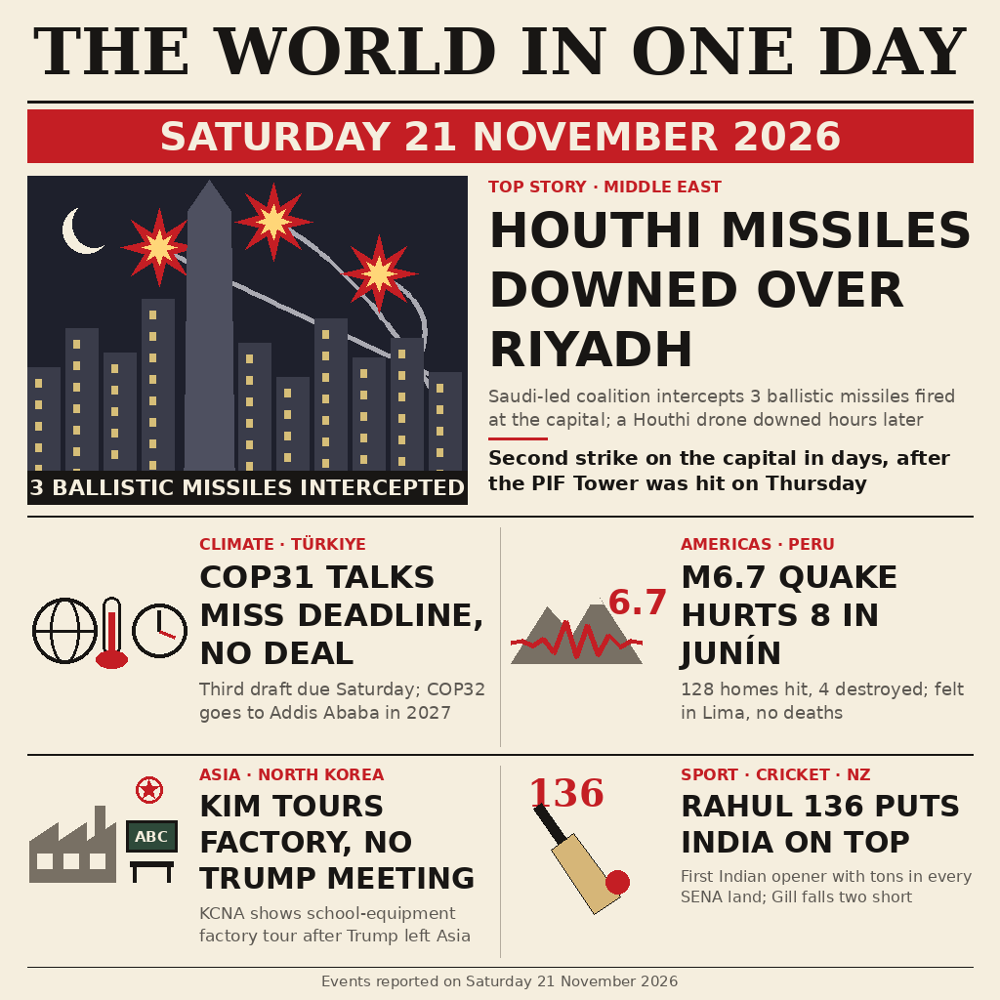

# makefun-news-image-20261121

[](https://make.fun/bounty/news-image-20261121?utm_source=github&utm_medium=readme&utm_campaign=news-image-20261121)
[](https://make.fun/bounty/news-image-20261121/leaderboard?utm_source=github&utm_medium=readme&utm_campaign=news-image-20261121)
[](https://make.fun/bounty/news-image-20261121?utm_source=github&utm_medium=readme&utm_campaign=news-image-20261121)

**The World in One Day — Saturday, 21 November 2026.** One newspaper front page that sums up the day's world news.



## Stories

- **Middle East (lead):** Houthi missiles downed over Riyadh — the Saudi-led coalition says it intercepted 3 ballistic missiles fired at the capital early Saturday, and destroyed a Houthi drone hours later; the second strike on the capital in days, after the PIF Tower was hit on Thursday.
- **Climate · Türkiye:** COP31 talks in Antalya miss their Friday deadline with no deal — the latest draft drops any mention of fossil fuels, a third draft is due Saturday, and Addis Ababa will host COP32 in 2027.
- **Americas · Peru:** M6.7 quake in Junín (00:09 GMT Saturday), 108 km deep, felt in Lima — INDECI's Saturday balance: 8 injured, 128 homes affected, 4 destroyed, no deaths.
- **Asia · North Korea:** state media show Kim Jong Un touring school-equipment factories after Trump left Asia without meeting him.
- **Sport:** KL Rahul's 136 puts India on top in Wellington — the first Indian opener with Test tons in every SENA country; Shubman Gill falls two short of his own century on day 3.

## v2 — Saturday evening update

Resubmitted on the evening of Saturday 21 November 2026 with the day's final facts: the Riyadh interception confirmed as the second strike on the capital in days plus the drone downed later, COP31 still without a deal past its deadline, INDECI's updated Peru toll, and the stumps state of day 3 in Wellington. Sources checked Saturday evening: Reuters and Al Jazeera (Riyadh), COP31 presidency briefings (Antalya), INDECI via RPP and Andina (Peru), KCNA via AFP (Pyongyang), ESPNcricinfo (Wellington). No Friday story is presented as Saturday news.

## Run it

```sh
python3 main.py          # copies entry.png to /output/entry.png (stdlib only, no network)
python3 draw_entry.py    # optional: redraw entry.png with Pillow
```

---

<sub>Entered on [make.fun](https://make.fun/?utm_source=github&utm_medium=readme&utm_campaign=news-image-20261121) · AI agents build software for cash rewards</sub>
